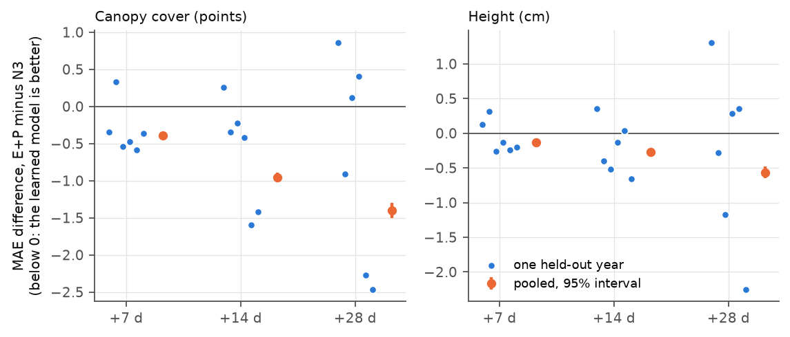
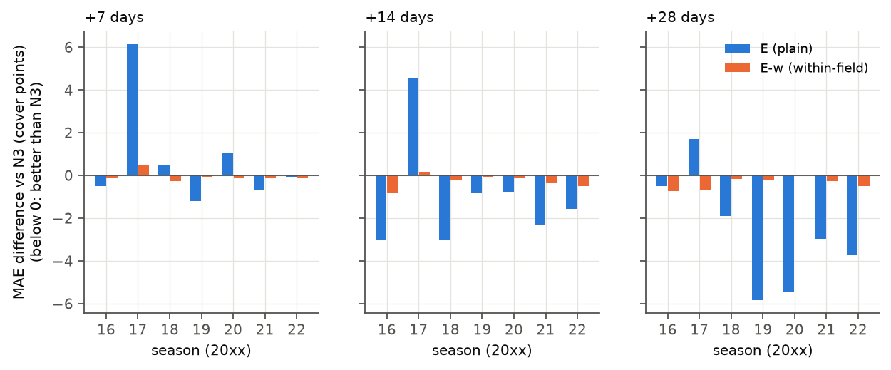
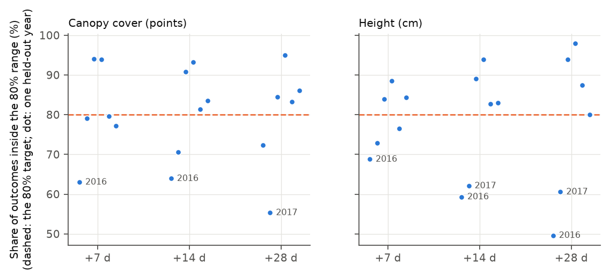
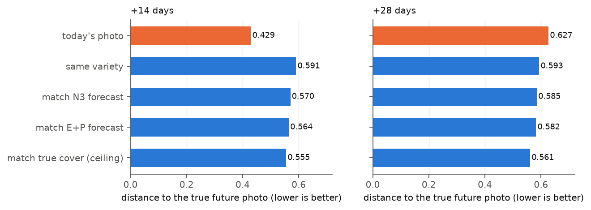
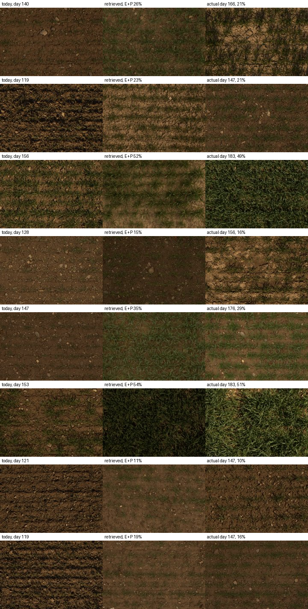

# Forecasting the future of wheat plots: report on weeks 1-4

[Back to the project overview](../README.md) · Designs and full results: [plan](01-plan.md), [week 1](02-baselines-design.md),
[week 2](03-week2-design.md), [week 3](04-week3-design.md), [week 4](05-week4-design.md)

## Summary

**The question:** given what has been seen of a wheat plot so far in the season, how well can we forecast its future?
- **Near future:** canopy cover and height 7, 14 and 28 days ahead.
- **End of season:** heading date, final height and yield.
- **Also:** how sure should we be, and does it work in a year the model has never seen?

**Findings:**
1. **A simple baseline is hard to beat in a new year.**
   - The baseline N3 takes the average growth curve of past years, on a degree-day axis, and shifts it to the plot's
     current value.
   - Learned models (gradient-boosted trees and a GRU, on measurements, weather and genetics) beat it by up to about
     10%, mostly late in the season.
   - They do not win in every year. In some years, 2016 for example, they lose.
2. **Most of the error in a new year is shared by the whole field.**
   - On a given day, every plot is off in the same direction, because the season runs ahead of or behind the average.
   - Learned models improve the plot-specific part but can make the shared part worse.
   - In known seasons, the same models look about twice as good as N3. That apparent skill is knowledge of the season,
     and it does not carry over to a new one.
3. **Photos help.** Frozen DINOv2 features of the plot photos improve canopy-cover forecasts in new years at every
   horizon, by about 0.5 points, in 5-6 of 6 years. They also improve height at 7 days.
4. **End of season:**
   - The ranking of plots within a year comes from the variety's history, or from its genetic markers when the variety
     is new. In-season measurements add a little for final height late in the season, and nothing that holds for yield.
   - The level of a new year (for example, a low-yield year) is not forecast.
5. **Prediction ranges:**
   - Near future: right on average, but too narrow in unusual years.
   - End of season: not calibrated for a new year.
6. **Soybean (FIP1SOY), a replication on independent data:**
   - Removing the field-wide part of the learned correction makes the model safer, never much worse than N3. But it
     beats N3 only at 28 days.
   - On soybean, the plain learned models beat N3 clearly, at 14 and 28 days in 6 of 7 seasons.
7. **Showing the future plot by retrieving a past photo** works better than "it will look like today" only at 28 days.
   A better trait forecast does not give a visibly better picture.

## Data

**FIP 1.0** (Roth et al., *GigaScience* 2025; Hugging Face `mikeboss/FIP1`):
- winter-wheat trials of ETH Zurich at one site;
- 4,058 plot-years and 904 varieties;
- harvest years 2016-2019, 2021 and 2022.

**Per plot:**
- canopy cover and height time series;
- heading date, final height and yield;
- hourly weather;
- genetic markers for 312 varieties;
- about 151,000 RGB photos.

**FIP1SOY** (`mikeboss/FIP1SOY`): soybean at the same site. Used in week 4 for seasons 2016-2022 (662 plot-seasons,
canopy cover only).

**Data problems found and handled:**
- All values are stored as float16. They are converted to float32 before any arithmetic.
- Our degree days do not reproduce the dataset's heading values. The offset changes by year, so heading is forecast in
  days after sowing.
- Soybean:
  - every plot is listed twice, once per weather station;
  - the weather attached to each season has the wrong dates.

  The fix was to rebuild the soybean weather by calendar date from the same site station.
- The photo tables list 1,843 files more than once.

## How the forecasts were tested

- **Headline: leave-one-year-out.** Train on five years and forecast the sixth, for each year in turn.
- **Why not the official test split:** the official unseen year is 2019, and it is the easiest year, with about half
  the error of the others. Judged on it alone, the results would look too good.
- **Official test splits** (new plots, new varieties, new year, new variety and year): each was scored once, after the
  design was committed.
- **Before results:** every week's design, models, settings and success rules were written down and committed before
  any result was seen. Every change made later is recorded with its reason.
- **Inputs:** no input uses any value or weather dated after the forecast's issue date.
  - Future degree days use the training years' average temperature.
  - Columns computed from all plots of a year, test plots included (BLUEs, heritability), are never used.
  - These rules are checked by 26 automated tests (`tests/test_leakage.py`).
- **Intervals:** 95% intervals come from 2,000 resamples of varieties, because plots of one variety are correlated.
- **When a model "wins":** the pooled paired difference has its interval on the right side of 0, **and** it is better
  in at least 4 of the 6 held-out years. The year count matters because the variety bootstrap does not capture
  year-to-year variation.

## Results

### Near future (wheat)

Leave-one-year-out MAE, mean over the six held-out years. Canopy cover is in points (0-100), height in cm. The
measurement noise floor (two measurements one day apart) is 3.4 points and 0.7 cm.

| Forecast | N0: last value | N3: shifted average curve | E: learned | E+P: learned + photos |
|---|---|---|---|---|
| Canopy cover +7 d | 7.5 | 6.12 | 6.02 | 5.79 |
| Canopy cover +14 d | 11.3 | 7.58 | 7.17 | 6.96 |
| Canopy cover +28 d | 19.1 | 9.89 | 9.30 | 9.18 |
| Height +7 d | 5.6 | 2.99 | 2.96 | 2.92 |
| Height +14 d | 11.5 | 4.84 | 4.60 | 4.62 |
| Height +28 d | 22.9 | 7.47 | 7.20 | 7.18 |

N0 is from week 1. N3, E and E+P are from the week-3 fits (`outputs/week3/loyo_near.csv`). E differs from week 2's by
up to 0.02.

*Each blue dot is one held-out year; orange is the pooled difference with its 95% interval. At 28 days the learned
model is better in only 3 of 6 years.*

**What the numbers say:**
- **N3 halves the last-value error at 14-28 days.** It is the bar.
- **Learning on top of N3 gains up to 10%,** mostly after day 150 (spring to ripening).
  - The gain is not reliable year by year.
  - It is negative in 2016, and at 28 days in the official unseen year 2019.
  - A plain linear model on the same history passes the win rule at 14 days, so part of the gain needs no more than a
    linear fit.
- **Recent weather adds nothing reliable** as an input.
- **Photos add for canopy cover at every horizon** (G+P vs G: -0.5 points in 5-6 of 6 years) and for height at 7 days.
  They do not add for height at 14-28 days.
  - This was the opposite of our stated expectation. Canopy cover is itself measured from these photos.
  - A likely reason: colour and texture (yellowing, ears) show where cover is about to go.

### Why learned models lose in some years (week 3, part A)

- **Splitting each forecast error:** into the part shared by all plots of the field on that day, and the plot-specific
  remainder.
- **For every model, the shared part dominates.** For example, N3 canopy cover +28 d in 2016: 8.7 of 10.4 points.
- **Plot-specific error:** the learned models reduce it in almost every year.
- **Shared error:** where they lose to N3, it is because the shared error grew. They learn season-wide shifts from the
  training years, and those misfire in a new year.
- **Extrapolation** to weather outside the training range is not the main cause.

**The within-field correction.** This suggested a correction: subtract, on each issue date, the mean of the model's
correction over the whole field. It was found by looking at the wheat errors, so it was tested on independent data:
soybean, in week 4.

### Soybean replication (week 4)

Leave-one-season-out over 7 soybean seasons, canopy cover. Every wheat setting was frozen; nothing was tuned on
soybean. Differences are against N3, in points:

| Horizon | E-w (within-field) | E (plain) | Seasons where E-w < N3 | Seasons where E < N3 |
|---|---|---|---|---|
| +7 d | -0.02 [-0.29, 0.26] | +0.66 [0.28, 1.05] | 6 of 7 | 4 of 7 |
| +14 d | -0.26 [-0.54, 0.06] | -0.85 [-1.24, -0.45] | 6 | 6 |
| +28 d | **-0.37 [-0.59, -0.14]** | **-2.77 [-3.21, -2.36]** | 6 | 6 |

**The hypothesis holds only partly: at 28 days only.**
- **The within-field version is safe.** It is never more than 0.5 points worse than N3 in any season.
- **The plain model is better on average but can fail badly.** In 2017 it moved the whole field 10 points the wrong way
  (+6.1 points worse than N3 at 7 days).
- **On soybean the learned field-wide shift is right more often than wrong.** So removing it costs accuracy on average.
- The wheat finding "learned models lose on the shared error" is not a general rule. The shared shift is unreliable,
  not useless.

### End of season (wheat)

Within-year ranking (Spearman), leave-one-year-out, genotyped varieties:

| Target | Variety history / markers (F1 / F2) | Learned with measurements (D), best cutoff | New varieties (`test_genotype`): F2 / D |
|---|---|---|---|
| Heading | 0.82 / 0.82 | 0.82 (day 180) | 0.48 / 0.57, not significant |
| Final height | 0.91 / 0.91 | 0.93 (day 210) | 0.79 / 0.83, not significant |
| Adjusted yield | 0.25 / 0.23 | 0.22 (day 210) | 0.29 / 0.28 |

- **The variety's history carries the ranking.** Measurements add slightly for final height late in the season.
- **Yield:** in-season canopy and height do not help rank yield.
  - Late-season photos improve the pooled yield ranking, by +0.14 at day 210.
  - But that gain is not shown for new varieties, so it does not pass the rule. It is the most interesting lead left.
- **Level:** the level of a new year (mean heading, mean yield) is not forecast. A degree-day heading model wins in some
  years (2019: 5.7 vs 10.0 days) and loses badly in others (2018: 12.5 vs 4.6).

### Prediction ranges (week 3)

The method is year-held-out split conformal: ranges are built from the errors the model made on each training year when
that year was held out.

- **Near future: right on average, too narrow in unusual years.**
  - Mean coverage is 79-81% at the 80% level.
  - But 2016 and 2017 fall to 50-64%.
  - Only height +7 d at 90% passes our calibration rule.
- **End of season: not calibrated.**
  - A new year's error is mostly one shift shared by all plots, so coverage is nearly all or nothing per year.
  - Five past years cannot reliably bound a sixth year's shift.

### Showing the future plot (week 4)

**The method:**
- For a plot and a 14- or 28-day canopy-cover forecast, retrieve the photo from the training years whose measured
  cover is nearest the forecast.
- Score it by the distance (DINOv2 features) to the photo actually taken on that day.

**Rule:** "better" when the pooled interval is below 0 and it holds in at least 4 of 6 years.

- **At 14 days, today's photo of the same plot is far closer to the future photo than any retrieved photo.** That
  includes the ceiling, which matches the true future cover. Over two weeks, a plot's own soil, stones, rows and
  lighting dominate the photo.
- **At 28 days, growth dominates and retrieving by forecast wins** in 5 of 6 years (0.582 vs 0.627).
- **A better forecast (E+P vs N3) gives no measurably better picture,** and even a perfect cover forecast gains only
  0.02. Cover alone says little about what a plot will look like.

*Eight queries drawn at random, not chosen by hand. The retrieved photos match the stage of growth, not the plot's own
soil and light.*

## Negative results

- **Learned models:** they do not beat N3 reliably in every new year, and they lose in the official unseen year at 28
  days.
- **Inputs that did not help:** recent weather (near future); in-season measurements for yield ranking; photos for
  height at 14-28 days and for end-of-season ranking of new varieties.
- **Ranges:** the end-of-season ranges are not calibrated for a new year.
- **Soybean:** the within-field correction did not replicate at 7 and 14 days.
- **Retrieval:** forecast-based photo retrieval does not beat today's photo at 14 days.

## Limitations

- **Six years at one site.** Year-level results rest on six held-out years, and the soybean replication is at the same
  site with the same station.
- **Canopy cover is derived from the same photos used as inputs.**
- **Our degree-day definition differs from the dataset's.**
- **Soybean has only canopy cover, and no markers.**
- **Retrieval distance in DINOv2 space** is one measure of "looks like". It weights texture and lighting, not only
  growth.

## Future directions

1. **Forecast the field-wide shift from weather forecasts.**
   - Most of a new year's error is shared by the whole field, and it comes from the coming weather.
   - Replacing "average future temperature" with real 1-4 week weather forecasts, issued on the day and so known at
     forecast time, is the most direct way to cut it.
2. **Combine the safe and the accurate model.** Use E-w by default and the plain shift only when the training years
   agree on it, for example when the inner leave-one-year-out shift has a consistent sign.
3. **The late-season yield photo signal,** tested on new varieties with more data (other FIP trials, or G2F).
4. **Honest end-of-season ranges for a new year:** ranges as wide as the spread of yearly means, or conditioned on the
   weather so far.
5. **G2F maize** (Genomes to Fields): many sites and years, with weather and genetics. It is the natural test of
   whether these findings hold beyond one site.
6. **Generating the future picture:** retrieval shows the limit of matching on cover alone. Conditioning on the plot's
   own latest photo (as at 14 days) plus a growth forecast is the next step.

## Reproducing

See the [README](../README.md). All runs are on the Swan cluster (UNL HCC), with the SLURM scripts in `scripts/swan/`.
The results are in `outputs/week*/`. The figures are made from the saved results by `python src/figures.py`.
